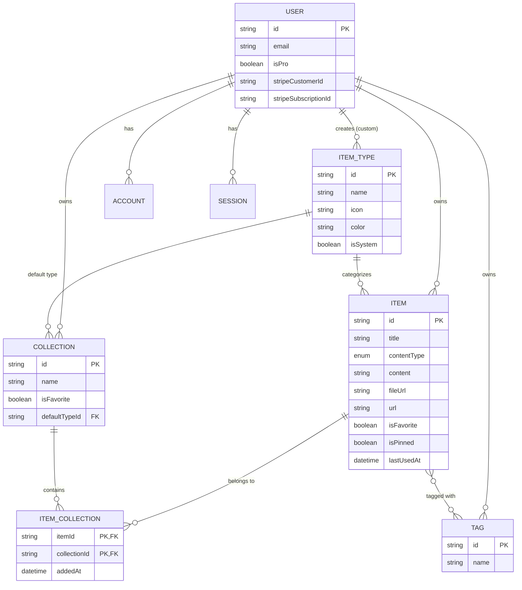
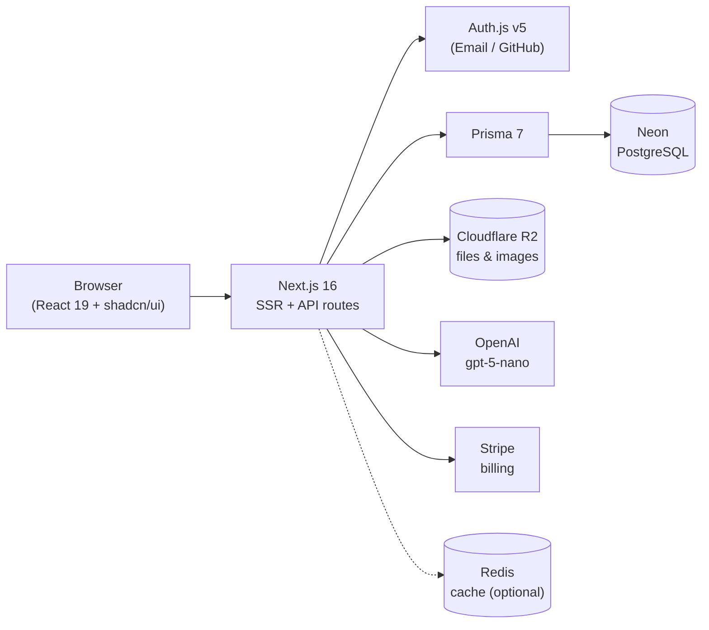

# DevStash — Project Overview

> **One fast, searchable, AI-enhanced hub for all your developer knowledge and resources.**

---

## Table of Contents

1. [The Problem](#1-the-problem)
2. [Target Users](#2-target-users)
3. [Features](#3-features)
4. [Data Model](#4-data-model)
5. [Tech Stack](#5-tech-stack)
6. [Monetization](#6-monetization)
7. [UI / UX](#7-ui--ux)
8. [Routes](#8-routes)
9. [Open Questions & Notes](#9-open-questions--notes)

---

## 1. The Problem

Developers keep their essentials scattered across too many places:

| Resource          | Where it usually lives    |
| ----------------- | ------------------------- |
| Code snippets     | VS Code, Notion           |
| AI prompts        | Chat histories            |
| Context files     | Buried in project folders |
| Useful links      | Browser bookmarks         |
| Docs              | Random folders            |
| Commands          | `.txt` files              |
| Project templates | GitHub Gists              |
| Terminal commands | Bash history              |

**Result:** constant context switching, lost knowledge, and inconsistent workflows.

**DevStash** brings all of it into one place that's fast to search, quick to add to, and enhanced with AI.

---

## 2. Target Users

| Persona                        | Needs                                                   |
| ------------------------------ | ------------------------------------------------------- |
| **Everyday Developer**         | Fast way to grab snippets, prompts, commands, and links |
| **AI-first Developer**         | Saves prompts, contexts, workflows, and system messages |
| **Content Creator / Educator** | Stores code blocks, explanations, and course notes      |
| **Full-stack Builder**         | Collects patterns, boilerplates, and API examples       |

---

## 3. Features

### A. Items & Item Types

Every item has a **type**. DevStash ships with a fixed set of **system types** (cannot be edited or deleted). Users will be able to create **custom types** later (Pro).

| Type    | Content Kind | Plan    | Color        | Icon (Lucide) |
| ------- | ------------ | ------- | ------------ | ------------- |
| Snippet | Text         | Free    | `#3b82f6` 🔵 | `Code`        |
| Prompt  | Text         | Free    | `#8b5cf6` 🟣 | `Sparkles`    |
| Note    | Text         | Free    | `#fde047` 🟡 | `StickyNote`  |
| Command | Text         | Free    | `#f97316` 🟠 | `Terminal`    |
| Link    | URL          | Free    | `#10b981` 🟢 | `Link`        |
| File    | File         | **Pro** | `#6b7280` ⚪ | `File`        |
| Image   | File         | **Pro** | `#ec4899` 🩷 | `Image`       |

- **Content kinds:** `TEXT` (snippet, prompt, note, command), `URL` (link), `FILE` (file, image)
- **Type routes:** `/items/snippets`, `/items/prompts`, `/items/links`, etc.
- Items are viewed and created in a **quick-access drawer**, not a separate page.

### B. Collections

- Users create collections that can hold items of **any type**.
- An item can belong to **multiple collections** (many-to-many).
  - e.g. a React snippet can live in both _React Patterns_ and _Interview Prep_.

Example collections:

| Collection        | Typical contents |
| ----------------- | ---------------- |
| React Patterns    | Snippets, notes  |
| Context Files     | Files            |
| Python Snippets   | Snippets         |
| Prototype Prompts | Prompts          |

### C. Search

Search across:

- Titles
- Content
- Tags
- Types

### D. Authentication

- Email / password
- GitHub OAuth

### E. Other Features

- ⭐ Favorite collections and items
- 📌 Pin items to top
- 🕒 Recently used items
- 📥 Import code from a file
- ✍️ Markdown editor for text types
- 📤 File upload for file types (file / image)
- 💾 Export data in multiple formats
- 🌙 Dark mode by default
- 🗂️ Add / remove items to and from multiple collections
- 🔗 See which collections an item belongs to

### F. AI Features (Pro)

| Feature              | Description                                      |
| -------------------- | ------------------------------------------------ |
| Auto-tag suggestions | Suggest tags based on item content               |
| Summaries            | Generate a short summary of an item              |
| Explain This Code    | Plain-language explanation of a snippet          |
| Prompt Optimizer     | Rewrite prompts to be clearer and more effective |

---

## 4. Data Model

> Rough draft — not set in stone. Auth models follow the [Auth.js Prisma adapter](https://authjs.dev/getting-started/adapters/prisma) schema.

### Entity Relationship Diagram



### Prisma Schema (draft)

```prisma
// prisma/schema.prisma
// Note: in Prisma 7 the database URL is configured in prisma.config.ts,
// not in the datasource block. Check the latest docs before setup.

generator client {
  provider = "prisma-client"
  output   = "../src/generated/prisma"
}

datasource db {
  provider = "postgresql"
}

// ─────────────────────────────────────────────
// Enums
// ─────────────────────────────────────────────

enum ContentType {
  TEXT
  URL
  FILE
}

// ─────────────────────────────────────────────
// Auth (Auth.js / NextAuth v5)
// ─────────────────────────────────────────────

model User {
  id                   String    @id @default(cuid())
  name                 String?
  email                String    @unique
  emailVerified        DateTime?
  image                String?
  password             String?   // hashed; null for OAuth-only users

  // Billing
  isPro                Boolean   @default(false)
  stripeCustomerId     String?   @unique
  stripeSubscriptionId String?   @unique

  accounts    Account[]
  sessions    Session[]
  items       Item[]
  itemTypes   ItemType[]
  collections Collection[]
  tags        Tag[]

  createdAt DateTime @default(now())
  updatedAt DateTime @updatedAt
}

model Account {
  userId            String
  type              String
  provider          String
  providerAccountId String
  refresh_token     String?
  access_token      String?
  expires_at        Int?
  token_type        String?
  scope             String?
  id_token          String?
  session_state     String?

  user User @relation(fields: [userId], references: [id], onDelete: Cascade)

  createdAt DateTime @default(now())
  updatedAt DateTime @updatedAt

  @@id([provider, providerAccountId])
}

model Session {
  sessionToken String   @unique
  userId       String
  expires      DateTime

  user User @relation(fields: [userId], references: [id], onDelete: Cascade)

  createdAt DateTime @default(now())
  updatedAt DateTime @updatedAt
}

model VerificationToken {
  identifier String
  token      String
  expires    DateTime

  @@id([identifier, token])
}

// ─────────────────────────────────────────────
// Core
// ─────────────────────────────────────────────

model Item {
  id          String      @id @default(cuid())
  title       String
  description String?
  contentType ContentType

  // TEXT types
  content  String?  // null for FILE / URL
  language String?  // e.g. "typescript", "bash" — for syntax highlighting

  // FILE types (Cloudflare R2)
  fileUrl  String?
  fileName String?
  fileSize Int?     // bytes

  // URL types
  url String?

  isFavorite Boolean   @default(false)
  isPinned   Boolean   @default(false)
  lastUsedAt DateTime? // powers "Recently used"

  userId String
  user   User   @relation(fields: [userId], references: [id], onDelete: Cascade)

  typeId String
  type   ItemType @relation(fields: [typeId], references: [id])

  tags        Tag[]
  collections ItemCollection[]

  createdAt DateTime @default(now())
  updatedAt DateTime @updatedAt

  @@index([userId])
  @@index([typeId])
  @@index([userId, isPinned])
  @@index([userId, lastUsedAt])
}

model ItemType {
  id       String  @id @default(cuid())
  name     String  // "snippet", "prompt", ...
  icon     String  // Lucide icon name
  color    String  // hex
  isSystem Boolean @default(false)

  // null for system types
  userId String?
  user   User?   @relation(fields: [userId], references: [id], onDelete: Cascade)

  items              Item[]
  defaultCollections Collection[]

  @@unique([name, userId])
}

model Collection {
  id          String  @id @default(cuid())
  name        String
  description String?
  isFavorite  Boolean @default(false)

  // Used to color empty collections
  defaultTypeId String?
  defaultType   ItemType? @relation(fields: [defaultTypeId], references: [id])

  userId String
  user   User   @relation(fields: [userId], references: [id], onDelete: Cascade)

  items ItemCollection[]

  createdAt DateTime @default(now())
  updatedAt DateTime @updatedAt

  @@index([userId])
}

model ItemCollection {
  itemId       String
  collectionId String
  addedAt      DateTime @default(now())

  item       Item       @relation(fields: [itemId], references: [id], onDelete: Cascade)
  collection Collection @relation(fields: [collectionId], references: [id], onDelete: Cascade)

  @@id([itemId, collectionId])
  @@index([collectionId])
}

model Tag {
  id   String @id @default(cuid())
  name String

  userId String
  user   User   @relation(fields: [userId], references: [id], onDelete: Cascade)

  items Item[]

  @@unique([name, userId])
}
```

### Seed Data — System Types

```ts
// prisma/seed.ts
const systemTypes = [
  { name: "snippet", icon: "Code", color: "#3b82f6" },
  { name: "prompt", icon: "Sparkles", color: "#8b5cf6" },
  { name: "note", icon: "StickyNote", color: "#fde047" },
  { name: "command", icon: "Terminal", color: "#f97316" },
  { name: "link", icon: "Link", color: "#10b981" },
  { name: "file", icon: "File", color: "#6b7280" },
  { name: "image", icon: "Image", color: "#ec4899" },
];
```

> ⚠️ **Database rule:** **Never** use `prisma db push` or edit the database structure directly. All schema changes go through migrations:
>
> ```bash
> npx prisma migrate dev --name <change_name>   # development
> npx prisma migrate deploy                     # production
> ```

---

## 5. Tech Stack

| Layer        | Choice                                          | Docs                                                                  |
| ------------ | ----------------------------------------------- | --------------------------------------------------------------------- |
| Framework    | Next.js 16 / React 19                           | [nextjs.org/docs](https://nextjs.org/docs)                            |
| Language     | TypeScript                                      | [typescriptlang.org](https://www.typescriptlang.org/docs/)            |
| Database     | Neon (serverless PostgreSQL)                    | [neon.com/docs](https://neon.com/docs)                                |
| ORM          | Prisma 7                                        | [prisma.io/docs](https://www.prisma.io/docs)                          |
| Auth         | Auth.js (NextAuth v5) — email/password + GitHub | [authjs.dev](https://authjs.dev)                                      |
| File storage | Cloudflare R2                                   | [developers.cloudflare.com/r2](https://developers.cloudflare.com/r2/) |
| AI           | OpenAI `gpt-5-nano`                             | [platform.openai.com/docs](https://platform.openai.com/docs)          |
| Styling      | Tailwind CSS v4                                 | [tailwindcss.com/docs](https://tailwindcss.com/docs)                  |
| Components   | shadcn/ui                                       | [ui.shadcn.com](https://ui.shadcn.com)                                |
| Icons        | Lucide                                          | [lucide.dev](https://lucide.dev)                                      |
| Payments     | Stripe                                          | [docs.stripe.com](https://docs.stripe.com)                            |
| Caching      | Redis _(maybe)_                                 | —                                                                     |

### Architecture

- **Single repo / single codebase** to keep overhead low.
- **SSR pages** with dynamic client components where needed.
- **API routes / server actions** for backend work: item CRUD, file uploads, AI calls, Stripe webhooks.



---

## 6. Monetization

Freemium model.

| Feature                  |          Free           |                  Pro                   |
| ------------------------ | :---------------------: | :------------------------------------: |
| **Price**                |           $0            | **$8/month** or **$72/year** (25% off) |
| Items                    |        50 total         |               Unlimited                |
| Collections              |            3            |               Unlimited                |
| System types             | All except File & Image |                  All                   |
| File & image uploads     |           ❌            |                   ✅                   |
| Custom types             |           ❌            |          ✅ _(coming later)_           |
| Search                   |          Basic          |                 Basic                  |
| AI auto-tagging          |           ❌            |                   ✅                   |
| AI summaries             |           ❌            |                   ✅                   |
| AI code explanation      |           ❌            |                   ✅                   |
| AI prompt optimizer      |           ❌            |                   ✅                   |
| Export data (JSON / ZIP) |           ❌            |                   ✅                   |
| Priority support         |           ❌            |                   ✅                   |

> 🛠️ **During development:** build the Pro foundation (`isPro` flag, limits, gating helpers), but **all users can access every feature**. Keep gating in one place (e.g. a `canUse(feature, user)` helper) so it can be switched on later with a single change.

---

## 7. UI / UX

### General

- Modern, minimal, developer-focused
- **Dark mode by default**, light mode optional
- Clean typography, generous whitespace
- Subtle borders and shadows
- Syntax highlighting for code blocks
- Inspiration: [Notion](https://www.notion.so), [Linear](https://linear.app), [Raycast](https://www.raycast.com)

### Screenshots

Refer to the screenshots below as a base for the dashboard UI. It does not have to be exact. Use it as a reference:

- @context/screenshots/dashboard-ui-main.png
- @context/screenshots/dashboard-ui-drawer.png

### Layout

```
┌───────────────┬──────────────────────────────────────────────┐
│  SIDEBAR      │  MAIN                                        │
│  (collapsible)│                                              │
│               │  Collections                                 │
│  Types        │  ┌──────────┐ ┌──────────┐ ┌──────────┐      │
│   </> Snippets│  │ React    │ │ Python   │ │ Context  │      │
│   ✨ Prompts  │  │ Patterns │ │ Snippets │ │ Files    │      │
│   ▢ Commands  │  │ (blue bg)│ │ (blue bg)│ │ (gray bg)│      │
│   ▤ Notes     │  └──────────┘ └──────────┘ └──────────┘      │
│   🔗 Links    │                                              │
│   📄 Files    │  Items                                       │
│   🖼 Images   │  ┌──────────┐ ┌──────────┐ ┌──────────┐      │
│               │  ┃ useAuth  │ ┃ git undo │ ┃ Refactor │      │
│  Collections  │  ┃ snippet  │ ┃ command  │ ┃ prompt   │      │
│   React...    │  └──────────┘ └──────────┘ └──────────┘      │
│   Python...   │   (colored border by type)                   │
│               │                                  ┌─────────┐ │
│               │                                  │ ITEM    │ │
│               │                                  │ DRAWER  │ │
└───────────────┴──────────────────────────────────┴─────────┘─┘
```

- **Sidebar:** item types (linking to `/items/<type>`) and latest collections.
- **Main:** grid of collection cards, then item cards.
  - **Collection cards** — _background color_ based on the item type they contain most of (falls back to `defaultType` when empty).
  - **Item cards** — _border color_ based on their type.
- **Item drawer:** individual items open in a quick-access side drawer for viewing and editing.

### Responsive

- Desktop-first, but fully usable on mobile.
- Sidebar becomes a drawer on mobile.

### Micro-interactions

- Smooth transitions
- Hover states on cards
- Toast notifications for actions
- Loading skeletons

---

## 8. Routes

| Route                  | Purpose                                      |
| ---------------------- | -------------------------------------------- |
| `/`                    | Marketing / landing page                     |
| `/sign-in`, `/sign-up` | Authentication                               |
| `/dashboard`           | Collections grid + recent / pinned items     |
| `/items/[type]`        | All items of a type (e.g. `/items/snippets`) |
| `/collections`         | All collections                              |
| `/collections/[id]`    | Items in a single collection                 |
| `/favorites`           | Favorited items and collections              |
| `/settings`            | Profile, billing, export                     |

_(Proposed — adjust as needed.)_

---

## 9. Open Questions & Notes

- **Link content type:** the original draft listed `contentType` as `text | file`. Links store a `url`, so a third `URL` value was added to the enum.
- **Tags** are scoped per user (`@@unique([name, userId])`) so users don't share or collide on tag names.
- **Recently used:** added `lastUsedAt` on `Item`; update it when an item is opened or copied.
- **Search:** start with PostgreSQL full-text search (or `ILIKE` for MVP); revisit if it gets slow.
- **File uploads:** upload directly from the browser to R2 with presigned URLs to avoid routing large files through the server. Set file size limits per plan.
- **Free plan limits** (50 items, 3 collections) should be enforced server-side, not just in the UI.
- **Export formats:** JSON / ZIP are listed for Pro — decide whether Markdown export should also be offered.
- **Redis:** defer until there's a measurable need.
