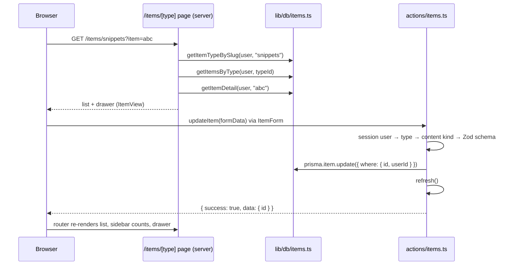

# Item CRUD Architecture

A design for one CRUD system that serves all 7 item types (snippet, prompt, command, note, file, image, link) through one action file, one query module, one dynamic route and shared components that adapt by type.

Sources: `context/project-overview.md`, `docs/item-types.md`, `prisma/schema.prisma`, `src/lib/item-type-display.ts`, plus the current patterns in `src/actions/profile.ts`, `src/lib/db/*`, `src/app/dashboard/*`, `src/proxy.ts`, `next.config.ts` and the Next.js 16.4 docs in `node_modules/next/dist/docs/`.

> Two listed sources don't exist: `docs/content-types.md` (this doc uses `docs/item-types.md`) and `src/lib/constants.tsx` (type constants are in `src/lib/item-type-display.ts`).

This is a proposal. Nothing here is built yet. Decisions that need your call are listed in [Open decisions](#open-decisions).

---

## Principles

1. **Actions only know content kinds, not types.** `createItem` / `updateItem` / `deleteItem` validate by content kind (`TEXT` / `URL` / `FILE`), work out the kind from the item's type on the server, and never branch on `"snippet"` vs `"prompt"`.
2. **Type-specific behavior lives in components.** Which editor, which preview and whether to show a language picker are decided by small switch components reading a single type config.
3. **Reads go through `src/lib/db/items.ts`, writes through `src/actions/items.ts`.** Server components call the query functions directly; client components only call server actions (as `coding-standards.md` requires).
4. **The session user owns everything.** Every query and mutation is scoped by `userId` from the session, never from the form or URL.
5. **Items open in a drawer, not a page** (project overview). The drawer's state lives in the URL, so it survives refreshes and can be shared.

---

## File structure

```
src/
├── actions/
│   └── items.ts                    # NEW  createItem, updateItem, deleteItem
├── lib/
│   ├── db/
│   │   └── items.ts                # EXTEND  getItemsByType, getItemDetail, getItemTypeBySlug
│   ├── item-types.ts               # NEW  per-type config: content kind, editor, language support
│   ├── item-type-display.ts        # KEEP  icons and color classes (unchanged)
│   └── validations/
│       └── items.ts                # NEW  Zod schemas per content kind
├── types/
│   └── items.ts                    # EXTEND  ItemDetail, ItemFormState, ItemContentKind
├── app/
│   └── (app)/                      # NEW route group sharing the sidebar shell (see Open decisions)
│       ├── layout.tsx              # MOVED from dashboard/layout.tsx
│       ├── dashboard/page.tsx      # MOVED, unchanged
│       └── items/
│           └── [type]/
│               ├── page.tsx        # NEW  list of one type + drawer slot
│               └── error.tsx       # NEW  same pattern as dashboard/error.tsx
└── components/
    └── items/                      # NEW
        ├── ItemList.tsx            # server: fetches and renders cards
        ├── ItemListSkeleton.tsx
        ├── ItemDrawer.tsx          # client: Sheet driven by ?item= / ?new=
        ├── ItemDetail.tsx          # server: fetches one item, picks view or form
        ├── ItemView.tsx            # read mode: shared header + ItemContentView
        ├── ItemContentView.tsx     # switch by type → CodeView / MarkdownView / LinkView / FileView
        ├── ItemForm.tsx            # client: shared fields + ItemContentField, useActionState
        ├── ItemContentField.tsx    # switch by content kind → TextContentField / UrlField / FileField
        ├── DeleteItemDialog.tsx    # alert-dialog, same pattern as DeleteAccountDialog
        └── NewItemButton.tsx       # replaces the display-only "New Item" button in TopBar
```

`ItemCard` stays in `src/components/dashboard/` and is reused by `ItemList`. It only needs to become a link (to `?item=<id>`); moving it to `components/items/` can come later.

---

## Routing: `/items/[type]`

### URL shape

| URL                              | Shows                                        |
| -------------------------------- | -------------------------------------------- |
| `/items/snippets`                | all snippets                                 |
| `/items/snippets?item=<id>`      | the list with that item open in the drawer   |
| `/items/snippets?item=<id>&edit=1` | the drawer in edit mode                    |
| `/items/snippets?new=1`          | the list with an empty create form in the drawer |

The segment is the **plural slug** the sidebar already links to (`getItemTypeHref()` → `/items/<name>s`). The drawer params work on any page, so the dashboard can open items in the same drawer (`/dashboard?item=<id>`) by rendering the same `ItemDrawer` slot.

### Resolving the slug

```ts
// src/lib/db/items.ts
export async function getItemTypeBySlug(userId: string, slug: string) {
  if (!slug.endsWith("s")) return null;
  return prisma.itemType.findFirst({
    where: { name: slug.slice(0, -1), OR: [{ isSystem: true }, { userId }] },
    select: { id: true, name: true },
  });
}
```

The page calls `notFound()` when this returns `null`, so `/items/foo` returns a 404. Looking the type up in the database (rather than checking a hard-coded list) means custom types work later without changes.

A naive plural breaks for names that already end in "s" (e.g. a custom type "class" → `/items/classs`). That's harmless for the 7 system types; custom types may need a stored `slug` column later.

### The page (Next.js 16.4 specifics)

```tsx
// src/app/(app)/items/[type]/page.tsx
export default function ItemsByTypePage({ params, searchParams }: PageProps<"/items/[type]">) {
  return (
    <Suspense fallback={<ItemListSkeleton />}>
      <ItemsByType params={params} searchParams={searchParams} />
    </Suspense>
  );
}
```

- `params` and `searchParams` are **Promises** in this version. Type them with the generated `PageProps<"/items/[type]">` helper (the layout already uses `LayoutProps<"/dashboard">`).
- `cacheComponents: true` is on in `next.config.ts`, so anything that awaits `params`, `searchParams` or the session must sit inside `<Suspense>`. Keep the page body itself synchronous, as `dashboard/page.tsx` and `profile/page.tsx` already do.
- The session lookup (`getSessionUserId()`) already calls `connection()`, so the list renders at request time.
- Add `"/items/:path*"` to the `matcher` in `src/proxy.ts` so signed-out visitors are sent to `/sign-in`.

---

## Data fetching: `src/lib/db/items.ts`

Extend the existing module, reusing `ITEM_SUMMARY_SELECT`, `RECENT_ORDER` and `toItemSummary()`:

| Function | Returns | Used by |
| -------- | ------- | ------- |
| `getItemTypeBySlug(userId, slug)` | `{ id, name } \| null` | the `[type]` page |
| `getItemsByType(userId, typeId)` | `ItemSummary[]`, pinned first, then `RECENT_ORDER` | `ItemList` |
| `getItemDetail(userId, itemId)` | `ItemDetail \| null`: all content fields, type, tags, collection ids and names | `ItemDetail` (drawer) |

- Every `where` includes `userId`. `getItemDetail` uses `findFirst({ where: { id, userId } })`, so another user's id behaves like a missing one.
- `ItemSummary` (cards) stays light; only `ItemDetail` loads `content`, which can be large.
- Pagination isn't needed for MVP (free plan: 50 items). Add `take` / cursor later.

---

## Mutations: `src/actions/items.ts`

One `"use server"` file with three actions, following `src/actions/profile.ts`: `safeParse` first, the session user from `getSessionUserId()`, Prisma calls in `try/catch`, and a `{ success, data?, error?, fieldErrors? }` result.

| Action | Signature | Notes |
| ------ | --------- | ----- |
| `createItem` | `(prev, formData) => ItemFormState` | form field `typeId`; result `data: { id }` so the drawer can switch to the new item |
| `updateItem` | `(prev, formData) => ItemFormState` | form field `id`; `where: { id, userId }` |
| `deleteItem` | `(itemId: string) => { success, error? }` | `delete({ where: { id, userId } })`; join rows cascade |

### Flow shared by create and update

1. Read `typeId` (and `id` for update) from the form.
2. Get the session user; return `NOT_SIGNED_IN` if none.
3. Load the type (`isSystem` or owned by the user) and get its **content kind** from `src/lib/item-types.ts`. Reject unknown or foreign types.
4. Parse the form with the schema for that content kind (below).
5. For update: refuse a `typeId` whose content kind differs from the item's current one (a snippet can become a note, not a link).
6. Write. Set `contentType` from step 3, and **clear the columns of the other kinds** (`url: null` for TEXT, and so on) so stale data can't linger.
7. Tags: `set: []` then `connectOrCreate` by `name_userId`, so tags stay per user.
8. Collections: only ids that belong to the user (check with one `count` query) are written to `ItemCollection`.
9. Call `refresh()` from `next/cache` so the open page (list, sidebar counts, dashboard) re-renders. With `cacheComponents` and no `"use cache"` data, there's no cache tag to invalidate yet; switch to `updateTag()` if item queries get cached later.

Prisma errors `P2025` (record not found or not owned) map to "Item not found"; everything else maps to the generic error, logged with `console.error` as the profile actions do.

### Validation: `src/lib/validations/items.ts`

```ts
const baseItem = {
  title: z.string().trim().min(1).max(200),
  description: z.string().trim().max(500).optional(),
  tags: z.array(z.string().trim().toLowerCase().min(1).max(30)).max(20),
  collectionIds: z.array(z.string()).max(50),
};

export const ITEM_SCHEMAS = {
  TEXT: z.object({ ...baseItem, content: z.string().min(1), language: z.string().max(30).optional() }),
  URL:  z.object({ ...baseItem, url: z.url() }),
  FILE: z.object({ ...baseItem, fileUrl: z.url(), fileName: z.string().min(1), fileSize: z.number().int().positive() }),
} satisfies Record<ContentType, z.ZodType>;
```

The `ContentType` enum comes from the generated Prisma client, so a new content kind fails type-checking until it gets a schema. The client form reuses the same schemas for instant field errors, as `RegisterForm` does with `registerSchema`.

### What stays out of the actions

- **No type names.** If an action needs `if (type === "snippet")`, that rule belongs in `item-types.ts` or a component.
- **File uploads.** FILE items arrive with `fileUrl` / `fileName` / `fileSize` already set. The upload itself (presigned R2 URL, progress) goes in an API route, per `coding-standards.md`, and is a separate feature.
- **Plan limits.** `createItem` should call a `canUse("createItem", user)` helper once one exists (50 free items, File/Image Pro only). During development it allows everything (project overview, §6).
- **Toggles** (favorite, pin) and `lastUsedAt` updates are small actions for the same file later; they're not part of this design's scope.

---

## Type-specific logic: `src/lib/item-types.ts`

One plain (non-React) config, importable by server actions and client components:

```ts
export interface ItemTypeConfig {
  contentKind: ContentType;            // TEXT | URL | FILE
  editor?: "code" | "markdown";        // TEXT types only
  hasLanguage?: boolean;               // shows the language picker
  accept?: string;                     // FILE types: input accept attribute
}

export const ITEM_TYPE_CONFIG: Record<string, ItemTypeConfig> = {
  snippet: { contentKind: "TEXT", editor: "code", hasLanguage: true },
  command: { contentKind: "TEXT", editor: "code", hasLanguage: true },
  prompt:  { contentKind: "TEXT", editor: "markdown" },
  note:    { contentKind: "TEXT", editor: "markdown" },
  link:    { contentKind: "URL" },
  file:    { contentKind: "FILE", accept: "*/*" },
  image:   { contentKind: "FILE", accept: "image/*" },
};
```

- **Actions** read only `contentKind` (via a `getContentKind(typeName)` helper with a fallback, e.g. `TEXT` for custom types).
- **Components** read the rest.
- `item-type-display.ts` keeps icons and color classes. It's separate because it imports Lucide React components and holds Tailwind classes, which actions shouldn't load.
- This also fixes the gap noted in `docs/item-types.md`: today the type → content kind mapping exists only inside `prisma/seed.ts`. The seed can import `getContentKind()` instead.

---

## Component responsibilities

| Component | Kind | Job |
| --------- | ---- | --- |
| `items/[type]/page.tsx` | server | Resolves the slug (`notFound()` if unknown), renders the header (type icon, label, count, "New" button), `ItemList` in `<Suspense>`, and the drawer slot. |
| `ItemList` | server, async | `getItemsByType()`; renders `ItemCard`s as links to `?item=<id>`; empty state per type ("No snippets yet"). |
| `ItemCard` (existing) | server | Unchanged look; wrapped in a `Link`. |
| `ItemDrawer` | client | shadcn `Sheet`. Open when `?item` or `?new` is present; closing calls `router.replace()` without those params. Renders server-provided children, so it holds no data. |
| `ItemDetail` | server, async | `getItemDetail()`; `notFound`-style message if `null`; renders `ItemView`, or `ItemForm` when `edit=1`. Wrapped in `<Suspense>` with a drawer skeleton. |
| `ItemView` | server | Shared header (icon, title, pin/favorite, tags, collections, dates) + `ItemContentView` + Edit / Delete buttons. |
| `ItemContentView` | server | **The only read-side switch on type.** `editor: "code"` → `CodeView` (syntax highlighted by `language`, copy button); `"markdown"` → `MarkdownView`; URL → `LinkView` (hostname, open in new tab); FILE → `FileView` (name, size, download), or an image preview for `image`. |
| `ItemForm` | client | `useActionState(createItem \| updateItem)`; shared fields (title, description, tags, collections); hidden `typeId` / `id`; inline field errors and a toast on success; closes or switches the drawer to view mode when done. |
| `ItemContentField` | client | **The only write-side switch on content kind.** TEXT → `TextContentField` (code or Markdown textarea, plus the language picker when `hasLanguage`); URL → `UrlField`; FILE → `FileField` (placeholder until uploads exist). |
| `DeleteItemDialog` | client | Confirm with Cancel / Delete, calls `deleteItem`, then closes the drawer; same Base UI alert-dialog as `DeleteAccountDialog`. |
| `NewItemButton` | client | Opens the drawer with `?new=1` on the current page; on a `/items/[type]` page the type is preselected, elsewhere the form starts with a type picker. |

Adding an 8th type (or custom types) then means: one row in `ITEM_TYPE_CONFIG`, one row in `ITEM_TYPE_DISPLAY`, and a seed entry. No route, action or query changes.

---

## Request flow



---

## Open decisions

1. **Sharing the sidebar shell.** `/items/[type]` should have the same sidebar and top bar as `/dashboard`. The proposal moves `dashboard/layout.tsx` into a `src/app/(app)/` route group shared by `dashboard`, `items` (and later `collections`, `favorites`). URLs don't change. The alternative, without moving files, is extracting the shell into an `AppShell` component and adding `items/layout.tsx` that renders it. Either touches existing files, so it needs your approval.
2. **Demo user vs session user.** The dashboard and sidebar still use `getCurrentUserId()` (the seeded demo user). Items pages and actions should use `getSessionUserId()`, otherwise users would edit the demo user's data. Using different users in the same shell would show different counts, so both should switch to the session user together, ideally as their own step before item CRUD.
3. **Editor and highlighting libraries.** The spec asks for a Markdown editor and syntax highlighting; none is installed. Pick them when building `CodeView` / `TextContentField` (a plain `<textarea>` works for a first version).
4. **Toasts.** The coding standards say to show action results as toasts, but no toast library is installed yet (auth uses inline alerts). shadcn's `sonner` would be the usual choice.
5. **Feature split.** Suggested order: (a) shell + session user, (b) list page and drawer view (read only), (c) create / edit / delete for TEXT and URL types, (d) FILE types with uploads.
